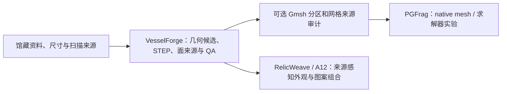

# VesselForge Core

VesselForge（VF）是 RelicWeave 工作区里独立安装的器物几何与资产打包原型。它以真实器物来源和明确标注的设计假设为基础，生成可检查的 CAD、网格、表面字段、来源链和几何 QA。项目仍在研究阶段，不是完整的通用历史器型生成器。

> **状态（2026-10-16）：开发已按用户要求暂停。** 当前只进行 GitHub 交付和文档工作；尚未恢复新功能、求解器或物理实验。暂停说明和恢复顺序见[交接记录](docs/handover/20261016/PAUSE_AND_RESUME.md)。

## 开发环境

`pyproject.toml` 是当前安装依赖的唯一入口；本仓库没有 `requirements.txt` 或 `environment.yml`。CI 在 Windows 和 Ubuntu 上覆盖 Python 3.11、3.12、3.13。当前工作区实际使用的原生 Windows 环境是 Python 3.12.14、CadQuery 2.8.0、`cadquery-ocp` 7.9.3.1.1、NumPy 2.5.3、pytest 8.4.2。这里的精确版本记录本机通过的环境，不是对所有平台的锁定版本。

在 Windows PowerShell 中，从本仓库根目录运行：

```powershell
python --version  # 使用 Python 3.11–3.13
python -m venv .venv
.\.venv\Scripts\python.exe -m pip install --upgrade pip
.\.venv\Scripts\python.exe -m pip install -e ".[test]"
.\.venv\Scripts\python.exe -m pytest
.\.venv\Scripts\vesselforge.exe --help
```

Unix shell 对应命令为 `python3 -m venv .venv`、`source .venv/bin/activate`、`python -m pip install -e ".[test]"` 和 `python -m pytest`。若需检查旧 CLI 的小型安装样例：

```powershell
.\.venv\Scripts\vesselforge.exe generate --out .\out\vf-smoke --pattern four_bands --seed 20261003
.\.venv\Scripts\vesselforge.exe validate .\out\vf-smoke
```

这个 `generate` 命令只生成早期的小型旋转体加扫掠柄 smoke specimen（默认主体宽 41 mm、高 56 mm、目标壁厚 4 mm）。它不是 10 月的 Aberdeen / Met 来源器型，也不是完整器型目录或物理模型。该 CLI 的力学字段是示意值并标记为 `UNVALIDATED_PROTOTYPE`；彩绘色带是可复现的纯光学规则、没有几何浮雕，也未验证其历史风格。对应 API 是 `vesselforge.create_asset_package(...)` 和 `vesselforge.validate_asset(...)`。安装和测试的 CI 定义见 [ci.yml](.github/workflows/ci.yml)。

### 核心依赖与可选 Gmsh

| 层 | 配置与当前证据 |
|---|---|
| Python 包 | `requires-python = ">=3.11,<3.14"`；构建使用 `hatchling>=1.24`。 |
| 必需运行依赖 | `cadquery>=2.8,<2.9`、`numpy>=2.0,<3`。当前 Windows 运行记录为 CadQuery 2.8.0 / OpenCascade Python bindings (`cadquery-ocp`) 7.9.3.1.1 / NumPy 2.5.3。CadQuery wheel 已带 OCP 绑定；标准安装不需要另装系统级 OpenCascade。 |
| 测试依赖 | 可选 extra `test` 安装 `pytest>=8.2,<9`；当前记录为 pytest 8.4.2。 |
| Gmsh 原生 SDK | 不属于 VF 的 pip 依赖。当前 Windows run05 harness 使用 Gmsh 4.15.2 的 `gmsh.py` 与 `gmsh.dll`，从共享工作区根目录下的 `third_party/pgfrag-geometry-runtime/sdk/gmsh-4.15.2-Windows64-sdk/lib` 加载，并通过 `os.add_dll_directory` 配置 DLL 搜索。该 SDK 不在独立 VesselForge 克隆中；需要相应几何实验时，应单独获取官方 SDK、按实验脚本配置路径，并阅读 SDK 的 `share/doc/gmsh/LICENSE.txt`（GPL-2.0-or-later，附例外）。核心安装、CLI smoke 和普通 VF 测试不需要 Gmsh。 |

当前工作区安装包的 metadata 将 CadQuery 和 `cadquery-ocp` 标为 Apache-2.0、NumPy 标为 BSD-3-Clause 及其组件许可证、pytest 标为 MIT；发布时应以实际解析到的 wheel 内许可证文件及其依赖许可证为准。Gmsh SDK 有单独许可证。**VesselForge 仓库当前没有 `LICENSE` 文件或项目许可证声明**；依赖许可证不决定本项目源代码的再使用权，发布前仍需单独处理。

## 当前交付状态

较早的全尺寸 v5 网格仅是诊断结果：STEP 导入时所有外表面 FID/角色仍为 `UNKNOWN`。16 个已知来源 FID 的 ancestry 证据来自后续 v6 run05，不能把 v5 结果当成同一来源映射验收。

截至 2026-10-16，进度按可核对交付物说明，不用估算百分比：

- **已有可复核的几何候选。** [v6 器型实验目录](experiments/continuation_20261016/reference_v6_tetra/)及相关来源记录保存了 Aberdeen 日用器 v6、Met 18.56.44 v2 等来源引导候选，以及若干独立器型变体的 STEP、剖面、面来源和结构报告。局部未量测的足部、壁厚或截面仍是明示假设；这些候选不等同实物复刻。
- **run05 几何与来源映射检查通过。** [本地审计回执](experiments/continuation_20261016/reference_v6_tetra/run05/audit_receipt.json)和[运行状态](experiments/continuation_20261016/reference_v6_tetra/run05/run_status.json)记录 86,624 个正体积 T4、44,182 个外表面三角形和 356 个分割界面三角形。外表面继承了 16 个来源 FID/角色；每个界面三角形有两个不同分区父单元。相对 CAD 的网格体积误差是 **0.240308%**。工作区根目录 `experiments/continuation_20261016/root_v6_run05_readback.json` 有独立读回结果 PASS；该文件位于 VesselForge 独立仓库之外。
- **几何通过不代表形状或物理验收。** run05 两处足圆角的网格面面积相对 CAD 仍分别约为 **-9.72% / -8.70%**。该结果只支持几何、序列化和来源映射诊断，不能证明真实器物形状、形状细节精度、材料参数、破裂行为或训练数据资格。run05 的零步 native 初始化/成本预检仍待完成；没有在 run05 上完成求解器演化或断裂。
- **材质和纹样仍是来源代理与研究基础。** 现有来源感知涂层/材质配方、青花表面场及渲染管线是后续工作基础；Met 50899 青花图案目前来自烧成后照片的局部投影，尚非复原的原始颜料场或完整连续纹样。刷痕密度、颜料扩散和实际器表构图仍需继续精修。
- **已完成的物理包数量为零。** 现有零步预检和小型数值控制不等同真实器物破裂。v5 网格、预插入弱缝案例和 run05 geometry-only 结果不可互相替代，也不能作为 run05 的破裂结果。

更完整的验收边界、失败项和恢复优先级写在[暂停与恢复交接](docs/handover/20261016/PAUSE_AND_RESUME.md)。

跨仓接手从 [2026-10-16 总交接入口](https://github.com/xiemonb666/relicweave-synlab/blob/main/docs/handover/20261016/START_HERE.md) 开始，其中包含工作区恢复、证据索引、依赖和总方案更新。暂停交付离线验证为 VF 66、PG 55、A12 90 项 focused checks，共 211 项通过；不代表全仓测试或物理资格验收。共享根目录代码和小型证据归档于 A12 的 `workspace_support/`，运行时和大型原始轨迹留在本地并有清单。

## 目标和设计要求

目标覆盖**日用器具和考古/历史器物**，并按杯、碗、盘、罐、瓶、壶及带柄器等家族建立独立的、有来源的模型。每个家族的交付必须包含：

- 可追溯的真实形态来源，以及明确区分的来源事实、视觉推断和设计假设；照片不能被当作未经说明的尺寸、壁厚或截面测量。
- 多个通用参数和多个家族专属参数，并记录请求值、求解值和实现值；同时保留器型制造过程约束。
- 有真实内容和合理布局的纹样、来源感知的材质，以及材料和烧制工艺相容的外观。青花不能只用蓝色带或图标代替，需表达笔触密度、颜料扩散和构图关系。
- 对所有外部图像、网格和其他素材完成来源核验、精修和人工复核后，才允许进入最终交付；抓取、裁剪、单位通过或几何测试通过均不算完成精修。

当前实现只覆盖部分候选。模型/图片目录、许可和未知项见[可复用 3D 来源](docs/references/REAL_3D_SOURCES_20261015.md)及[器型来源目录](docs/references/REAL_WORLD_FORMS_20261015.md)。例如，Apsida SHM 17946:0047 的精修 v3 仍有七个 pinched vertex links，只能作为视觉参考，不能直接作为实体仿真输入；Met 50899 照片投影也仍是纹样代理。Met 对象页的 Public Domain 标注和 Apsida 记录的 CC BY-SA 4.0 仅适用于相应具体来源，不能推广为所有来源素材的通用许可。Aberdeen 图像权利也须按其来源记录单独处理。

Aberdeen 参考照片在来源记录中标注 © Chris Keenan，本轮未确认开放复用授权；不要把照片文件复制进最终资产。更多对象级许可和来源边界见上面的两个来源目录。

## 架构与协作边界



VF 的 `forge.asset.v1` 包使用毫米、右手 Z-up 坐标，包含 STEP solid、三角表面、在不可变 asset-local rest 坐标中计算的光学字段、来源记录、哈希、数据字典和 geometry-only QA。旋转剖面/面来源在 [revolved_profile.py](src/vesselforge/revolved_profile.py)、[face_witness.py](src/vesselforge/face_witness.py) 与 [named_step.py](src/vesselforge/named_step.py)；资产包与 CLI 在 [asset.py](src/vesselforge/asset.py)、[cli.py](src/vesselforge/cli.py)；表面/分割网格检查在 `step_partition.py`、`tetra_partition.py` 和 `tetra_audit.py`。`tests/` 是 VF 包的测试范围，`experiments/` 保存版本化实验和收据，`docs/references/` 保存来源、许可和未知项。

完整 STEP 的完整表面语义分类按裁剪面记录 OpenCascade 曲面类型/轴和面朝向法线，再投影到三角面来源；分类规则、版本、后端、采样 UV/法线和源 STEP 哈希随证据保存。完整器表面中若出现未知面，会阻止着色和资产生成；保留的断裂语义码不会赋给完整器物。

协作时保持项目职责分开：

- `vesselforge/` 负责器物几何候选、STEP 面身份/来源、几何网格与 QA，不负责宣称破裂物理已成立。
- 兄弟仓库 `pgfrag/` 负责 native 求解器、断裂和碎片实验；几何或来源映射通过并不自动通过 PGFrag 的物理或数据验收。
- 兄弟仓库 `relicweave-synlab/` 中的 A12 负责设计空间、材质/纹样生成和后续研究数据。母体器物应由可追溯的 VF 来源记录输入；不能按坐标邻近、Z 分带或渲染观感猜测面来源。

三个仓库有各自的 `pyproject`/运行环境和测试范围；不要把 PGFrag、A12 或 Gmsh SDK 默认为 VF 的安装依赖。材料常数、表面标签和来源身份须通过各自的来源回执传递，并在下游项目独立验证。

## 外部依赖和素材来源

标准安装从 PyPI 解析 CadQuery / OCP 和 NumPy；`pytest` 只通过 `test` extra 安装。Gmsh Windows SDK 是独立可选组件。下游 A12/PGFrag 的依赖和许可证由各自仓库说明，不能由 VF 的安装配置替代。

真实素材没有统一的开放许可。逐个对象核对来源目录所链接的馆藏记录和授权；保留要求的归属与 ShareAlike 信息，未开放授权或权利未知的图像不要复制进最终资产。工作区缓存的第三方扫描/SDK 不一定包含在独立 VF 仓库克隆中。

## QA 解释限制

- 侧壁分析剖面和实测平面底面的局部壁厚证据，不构成融合后整体的全局最小壁厚证明。
- 网格到 STEP 的偏差是固定偏差下的确定性有限采样，不是 Hausdorff 上界。局部曲面网格面积偏差仍可能明显，足圆角结果请参考上述 run05 数值。
- 当前 API 将线性三角化偏差限制在 0.04–0.25 mm、角度公差限制在 0.02–0.20 rad；范围外明确报错，不会静默裁剪。
- 所有字段、包内相对路径和哈希用于追溯与完整性验证；这些检查本身不能证明来源完整、历史纹样真实、材料校准或冲击破裂物理。校验器拒绝绝对路径、路径穿越、符号链接和哈希/字节数不匹配。
- canonical surface arrays 和规格有种子时可复现；STEP header 可能含时间戳，因此整个包不承诺字节级完全相同。

