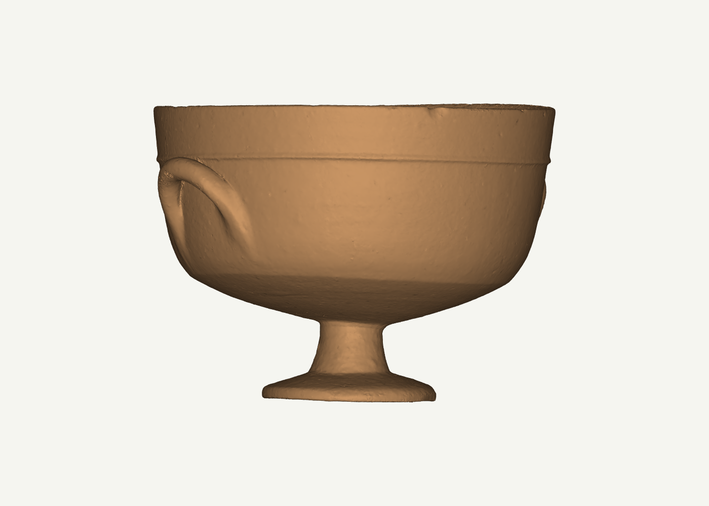
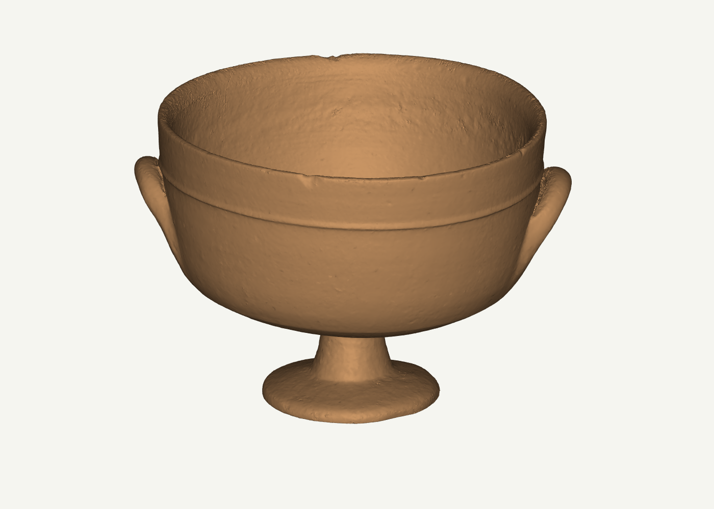
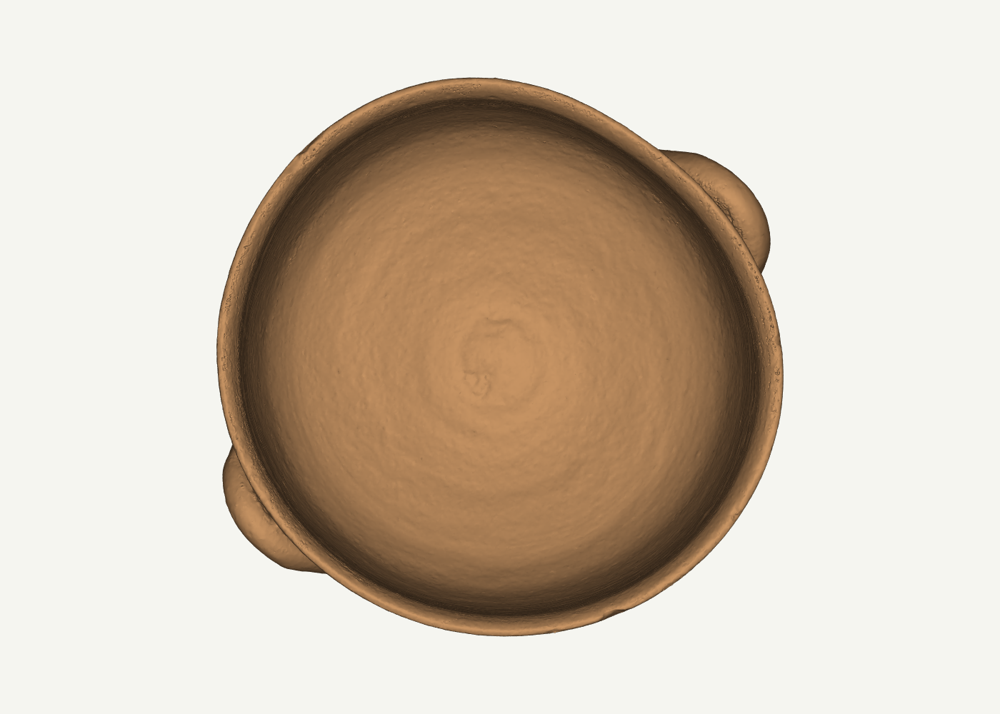
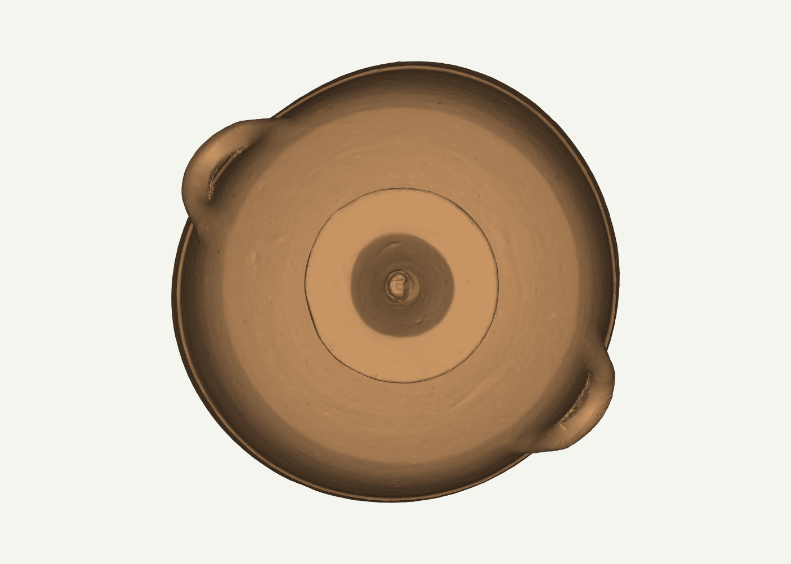
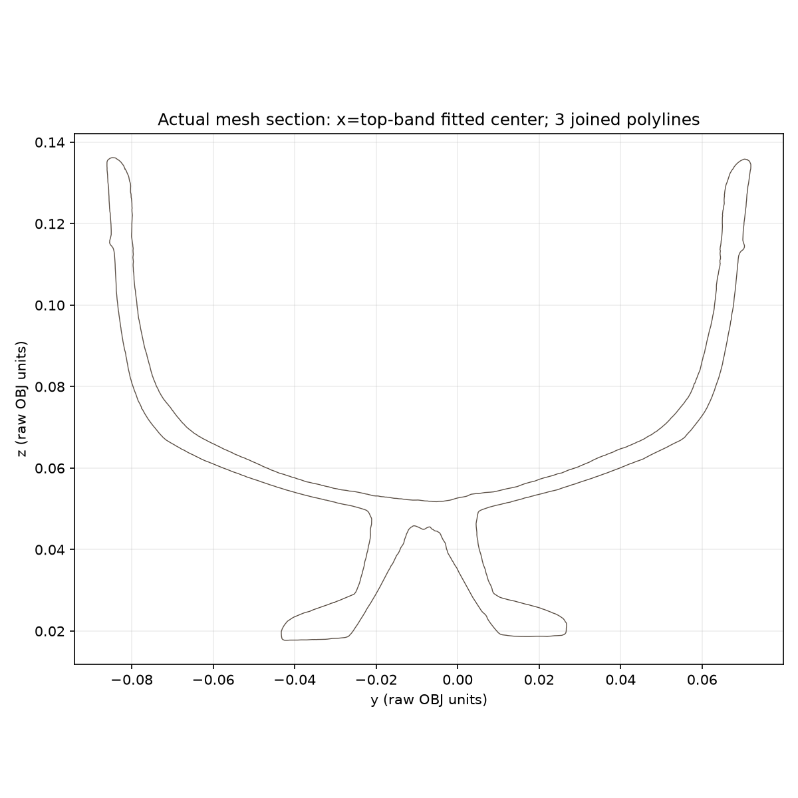

# Scanned anchor mesh audit — Apsida SHM 17946:0047

This audit inspects the actual OBJ geometry from the Apsida / Medelhavsmuseet footed bowl package. Attribution and license are in [the retained asset README](../../../../third_party/reference-assets/apsida-shm17946-0047/README.md). The source page reports C.G. III (850–700 BC), earthenware/clay/pottery, H 119 mm, base D 70 mm, rim D 160 mm, conical foot/cavity, segmented bowl body, sharp rim, and two horizontal round handles. The item page is [Apsida 49281](https://apsida.cut.ac.cy/items/show/49281); the downloadable OBJ archive is [here](https://apsida.cut.ac.cy/files/original/529/49281/Footed_Bowl_SHM_17946_0047_Obj06.zip).

## Findings for reuse

- The retained OBJ has 326,647 indexed XYZ vertices, 651,814 triangular faces, 342,151 UV coordinates, and 326,647 normals. Its header says `Generated with Agisoft Metashape`. No OBJ unit is declared.
- Raw coordinate bounds are X 0.160436, Y 0.158246, Z 0.119432. Z aligns with the reported 119 mm height if one *candidate* interpretation is 1 raw unit = 1 m (×1000 to mm). This is a scale hypothesis, not a native-unit declaration.
- Under that candidate scale, Z is 119.432 mm (+0.36% vs reported H); X/Y bounds are 160.436/158.246 mm. A least-squares circle over the topmost 0.003 raw-unit band has diameter 0.153961 raw units (153.961 mm at that candidate scale), with 0.002132 raw-unit radial RMS. A low-bottom-band radial diameter estimate is 0.072742 raw units (72.742 mm at candidate scale). These mesh diagnostics do not reproduce the reported rim D 160 mm and base D 70 mm exactly. Do not scale or claim calibrated dimensions from this audit alone.
- Two orthogonal vertical cuts through a least-squares center estimated from the top rim band show paired inner/outer wall surfaces and the raised foot/foot cavity. The fitted axis is a diagnostic candidate, not a source-declared axis. The X cut yields three disconnected polylines and the Y cut one; every line is retained in the section CSV and no semantic handle/component assignment is made. No handle loop is visible in the Y section, making that section a useful meridian diagnostic for a future rotational core; this is a slice through the complete source mesh, not a handle-removed model or a claim that the real vessel is perfectly rotational. The top and oblique views visibly show the interior and two side handles; the bottom view shows the underside foot area. All section coordinates remain in raw OBJ units.
- Indexed-edge incidence gives zero boundary edges and zero edges with incidence >2, with four triangles below the recorded raw-area tolerance. This is a closed indexed triangle surface, not proof that the physical pot is solid, the scan is complete, or all areas were directly captured.
- The mesh has 389 edge-connected components: the largest contains 643,336 faces (98.6993% of faces) and 99.9509% of total triangle area. The other 388 components remain in the raw NPZ and are listed in `component_table.csv`; they were not removed or declared noise. The largest component has consistent edge winding; all faces in the mesh were retained. There are 25 vertices with exact duplicate XYZ coordinates, not welded.

## Files

- `raw_geometry.npz`: `vertices_source_units` and `faces` arrays parsed from the original OBJ; original vertex indexing is preserved. No weld, rescale, repair, smoothing, decimation, or remeshing.
- `component_table.csv`: all 389 indexed edge-connected components, sorted by area (then absolute signed volume and face count); includes counts, raw-coordinate bounds, area, and signed volume. Component labels are audit labels only.
- `section_x_center.csv`, `section_y_center.csv`: point sequences for every connected polyline generated by cutting the original indexed mesh through the fitted top-band center in X/Y. They are raw-coordinate section traces, not fitted meridians or corrected profiles.
- `mesh_audit.json`: machine-readable measurements, source model SHA-256, component summary, and method notes.
- `audit_scan.py`: repeatable parser and audit/render script. It uses the Vesselforge Python runtime with NumPy/SciPy/VTK/Matplotlib.
- `scan_side.png`, `scan_oblique.png`, `scan_top.png`, `scan_bottom.png`: neutral-shaded renders of the actual source triangle mesh. `scan_side.png` is a true orthographic side view with the full stem and foot in view.
- `section_x_center.png`, `section_y_center.png`: central cuts of the source mesh.

## Processing and evidence boundaries

The downloaded ZIP was 21,934,200 bytes and had three safe, relative members; the ZIP listing contained no traversal paths or symlinks. Only the original OBJ and MTL were extracted. The JPG member was not extracted or viewed. The model stayed below the configured 2,000,000-vertex / 4,000,000-face limits.

The stock VTK OBJ reader warned on this file’s `v x y z r g b` rows and split its output, so topology was computed from a direct parser of the original OBJ `v` and `f` indices. VTK received that same indexed geometry for visualization and cutting. Temporary computed normals were used only for lighting. No surface was filled, rescaled, smoothed, remeshed, or repaired. A watertight indexed mesh can still include reconstruction closures or uncaptured areas; capture method, true coordinate units, physical wall thickness, and acquisition completeness remain **UNKNOWN**. Do not treat signed mesh volume or closed topology as a ceramic physical-solid qualification.
